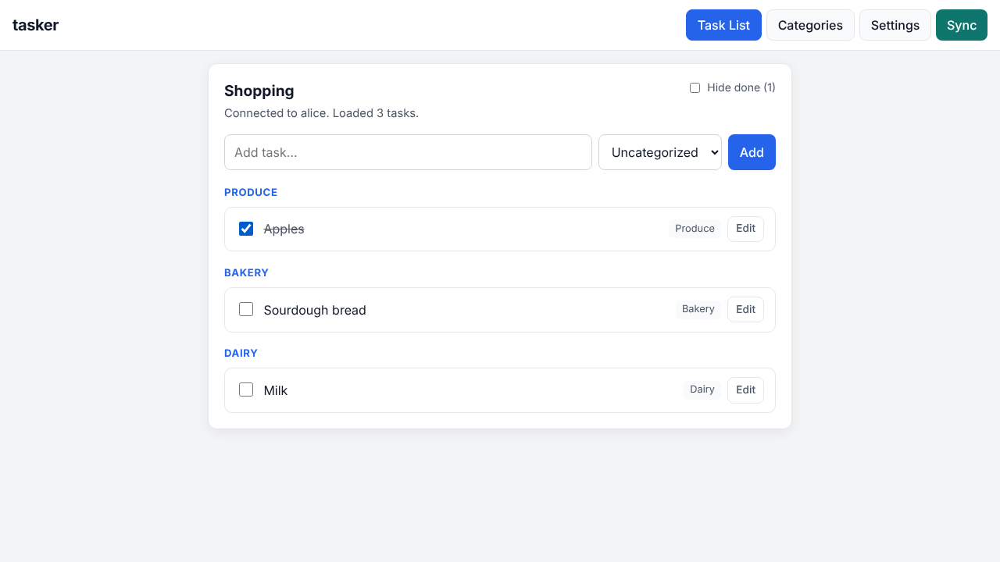
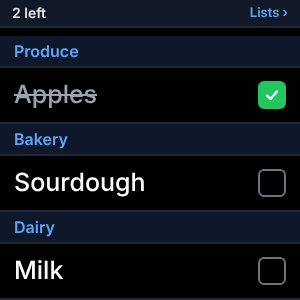

# tasker

A local-first, Bring-Your-Own-Backend (BYOB) task and grocery list management system backed by [Nextcloud](https://nextcloud.com/) (or any standards-compliant CalDAV/WebDAV server). There is no proprietary server, no telemetry, and no vendor lock-in: every task is stored as a standard iCalendar `VTODO` object over CalDAV, and shared per-list category configuration lives in a single JSON file on WebDAV.

## Applications

### Progressive Web App ([web/README.md](web/README.md))

An offline-first, mobile-friendly Progressive Web App for managing multiple CalDAV task lists, customizing per-list categories, resolving offline conflicts, and auto-categorizing uncategorized items on-device using the browser Prompt API (`LanguageModel`).



- Compact single-line header showing the active list and sync status (`Synced`, `Syncing…`, `Offline`)
- Slide-over side drawer for switching task lists and accessing **Categories** and **Settings**
- Floating `+` button for adding tasks, inline completion toggles, and full task editing
- Per-list category ordering synced via `tasker-config.json` (with one-click creation if the file does not exist yet)
- IndexedDB offline caching, Service Worker Background Sync, and manual `412` conflict resolution

See **[web/README.md](web/README.md)** for setup, Nextcloud CORS configuration, and usage instructions.

---

### Fitbit Versa 2 App ([fitbit/README.md](fitbit/README.md))

A wrist checklist watch app and smartphone companion app for **Fitbit Versa 2** (`mira`, Fitbit OS 4) that syncs your CalDAV task lists over Bluetooth so you can check off items while shopping.



- Launches immediately into your remembered task list from local Fitbit File Storage while refreshing updates in the background
- Instant local check/uncheck (records timestamps locally without blocking the UI; syncs on tap of **Sync**, reconnect, or next launch)
- Compact **Lists** sub-view to switch between available VTODO lists while hardware Back exits cleanly from the top-level list
- Timestamp-aware reconciliation (newer server edits win; newer watch check-offs push losslessly to CalDAV)
- Shares per-list category sorting with the web app via `tasker-config.json`

See **[fitbit/README.md](fitbit/README.md)** for building, installing onto a Versa 2, and usage instructions.

---

## Architecture Overview

```text
┌─────────────────────────────────────────────┐
│               Nextcloud Instance             │
│  ┌──────────────┐   ┌──────────────────────┐ │
│  │  CalDAV       │   │  WebDAV              │ │
│  │  (VTODO tasks)│   │  (config & recipes)  │ │
│  └──────────────┘   └──────────────────────┘ │
└───────────────────────────┬─────────────────┘
                            │ HTTPS + App Password
               ┌────────────┴────────────┐
               │                         │
    ┌──────────▼──────────┐   ┌──────────▼──────────┐
    │  PWA (web/)         │   │  Fitbit Companion    │
    │  TypeScript + Vite  │   │  (fitbit/companion/) │
    │  IndexedDB + SW     │   │  ┌──────────────┐   │
    └─────────────────────┘   │  │ Bluetooth BLE│   │
                              │  └──────┬───────┘   │
                              └─────────┼────────────┘
                                        │ Messaging API
                              ┌─────────▼───────────┐
                              │  Fitbit Watch App    │
                              │  (fitbit/app/, OS 4) │
                              │  File Storage API    │
                              └─────────────────────┘
```

Both clients share domain models, lossless `VTODO` parsing/serialization, CalDAV/WebDAV clients, category sorting, and sync logic via `@tasker/core` (`packages/core/`). See [docs/DESIGN.md](docs/DESIGN.md) for full technical details.

## Nextcloud Quick Prerequisites

- A running [Nextcloud](https://nextcloud.com/) instance with CalDAV enabled (default).
- A dedicated **App Password** (**Personal Settings → Security → Devices & sessions → Create new app password**).
- For the web app across origins (e.g., GitHub Pages): the [WebAppPassword](https://apps.nextcloud.com/apps/webapppassword) Nextcloud app configured with your PWA's origin (details in [web/README.md](web/README.md)).

## Local Development

All workspace packages (`packages/core`, `packages/mock-caldav`, `web`, and `fitbit`) are managed from the repository root:

```bash
# Install all workspace dependencies
npm install

# Start the PWA development server
npm run dev

# Run unit and integration tests across all packages
npm test

# Run Playwright E2E + zero-pixel visual regression tests (PWA + Fitbit)
npm run test:e2e

# Build core packages, web PWA, and Fitbit Versa 2 (.fba) bundle
npm run build
```

## Documentation

| Document | Description |
|---|---|
| [web/README.md](web/README.md) | PWA setup, Nextcloud CORS configuration, and usage guide |
| [fitbit/README.md](fitbit/README.md) | Fitbit Versa 2 build, installation, companion setup, and usage guide |
| [docs/DESIGN.md](docs/DESIGN.md) | Architecture, data models, CalDAV/WebDAV contracts, and sync protocols |
| [docs/TESTING.md](docs/TESTING.md) | Test layers, mock CalDAV server, Playwright harnesses, and CI |
| [docs/BACKLOG.md](docs/BACKLOG.md) | Development milestones and roadmap |

## License

[MIT](LICENSE)
