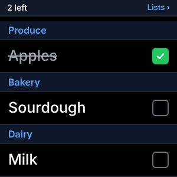
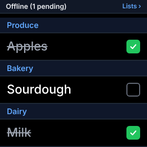

# Test: Fitbit Versa 2 Multi-List & Offline Sync

As a Versa 2 user, I want to pick between my CalDAV task lists, check off items sorted by category online or offline, survive restarts from local watch storage, and go back to switch lists.

## Versa 2 shows available VTODO task lists (filtering out VEVENT-only calendars)

**Verifications:**
- [x] Status shows 2 available lists
- [x] Shopping and Hardware lists are shown

---

## Selecting Shopping opens the top-level list view sorted by category (Produce → Bakery → Dairy); hardware Back exits cleanly

**Verifications:**
- [x] Lists sub-view button is visible and status shows 3 left
- [x] Pressing Versa 2 hardware Back from top-level task list does not hijack exit or forget the selected list
- [x] Items appear in category order: Apples, Sourdough, Milk

---

## Tapping Apples toggles instantly on the watch and persists COMPLETED losslessly to CalDAV on the next sync

**Verifications:**
- [x] Apples tile is checked and status updates to 2 left
- [x] Mock CalDAV server persisted COMPLETED and preserved X-PRESERVE

---

## Watch restarts immediately into the stored Shopping list from Fitbit fs cache with pending toggle intact

**Verifications:**
- [x] Status shows Offline (1 pending) immediately after restart
- [x] Milk remains checked from local per-list fs storage

---

## Reconnecting syncs the newer offline watch toggle to CalDAV and clears pending state

**Verifications:**
- [x] Status clears pending count and shows 1 left
- [x] Milk is persisted as COMPLETED in CalDAV with X-PRESERVE intact

---

## User opens the Lists sub-view and switches to the Hardware list

**Verifications:**
- [x] Hardware list task Wood Screws is displayed

---

