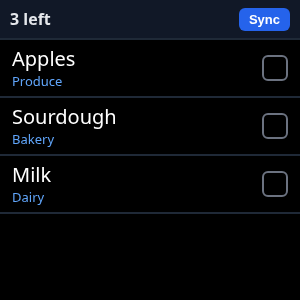
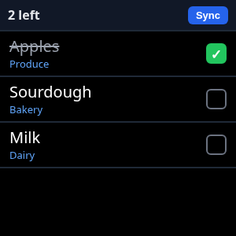
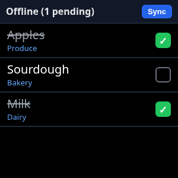
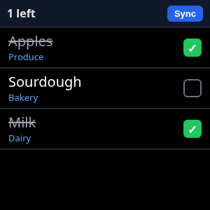

# Test: Fitbit Versa 2 Grocery Sync

As a Versa 2 user shopping at the store, I want my grocery list sorted by aisle on my wrist, check off items online or offline, and sync updates losslessly back to CalDAV.

## Versa 2 loads tasks sorted by aisle walk order (Produce → Bakery → Dairy)

**Verifications:**
- [x] Status shows 3 items left
- [x] First tile is Apples (Produce), second is Sourdough (Bakery), third is Milk (Dairy)

---

## Tapping Apples checks it off on the watch and persists COMPLETED losslessly to CalDAV

**Verifications:**
- [x] Apples tile is checked and status updates to 2 left
- [x] Mock CalDAV server persisted COMPLETED and preserved X-PRESERVE property

---

## Offline toggle survives watch restart via Fitbit File Storage (fs) cache

**Verifications:**
- [x] Status shows Offline (1 pending) after restart
- [x] Milk remains checked from local fs cache

---

## Reconnecting Bluetooth replays queued watch toggle and clears pending status

**Verifications:**
- [x] Status clears pending count and shows 1 left
- [x] Milk is persisted as COMPLETED in CalDAV with X-PRESERVE intact

---

