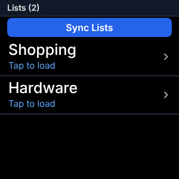
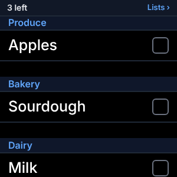
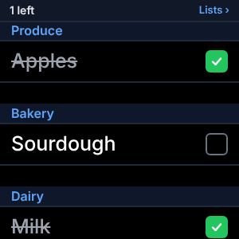
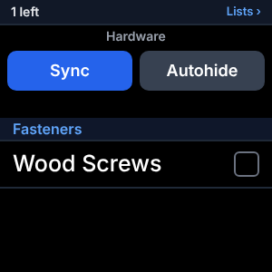

# Test: Fitbit Versa 2 Multi-List & Offline Sync

As a Versa 2 user, I want to pick between my CalDAV task lists, check off items sorted by category online or offline, survive restarts from local watch storage, and go back to switch lists.

## Versa 2 shows available VTODO task lists (filtering out VEVENT-only calendars)

**Verifications:**
- [x] Status shows 2 available lists
- [x] Shopping and Hardware lists are shown

---

## Selecting Shopping slides to the top-level Tasks page with short category headers (Produce → Bakery → Dairy), large-font task items, slim 28px status bar, and scrolled past the pull-down Sync tile

**Verifications:**
- [x] Slim status bar shows 3 left with Lists › hint and list starts scrolled past rows 0-1 onto row 2
- [x] Pressing Versa 2 hardware Back from top-level task list does not hijack exit or forget the selected list
- [x] Category headers and large-font tasks appear in order: Produce/Apples, Bakery/Sourdough, Dairy/Milk

---

## Tapping Apples toggles instantly on the watch; pulling down and tapping Sync persists COMPLETED losslessly to CalDAV

**Verifications:**
- [x] Apples tile is checked, status updates to 2 left, and list scrolls back past actions tile (value=2)
- [x] Mock CalDAV server persisted COMPLETED and preserved X-PRESERVE

---

## Watch restarts immediately into the stored Shopping list from Fitbit fs cache with pending toggle intact

**Verifications:**
- [x] Status shows Offline (1 pending) immediately after restart
- [x] Milk remains checked from local per-list fs storage

---

## Reconnecting syncs the newer offline watch toggle to CalDAV and clears pending state

**Verifications:**
- [x] Status clears pending count and shows 1 left
- [x] Milk is persisted as COMPLETED in CalDAV with X-PRESERVE intact

---

## User swipes from the right to the Lists page and switches to the Hardware list

**Verifications:**
- [x] Hardware list category Fasteners and task Wood Screws are displayed

---

