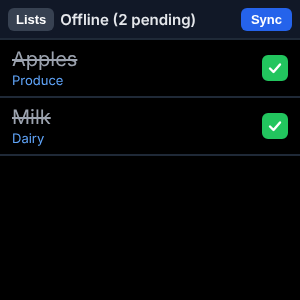
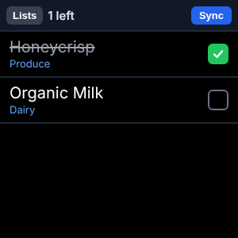

# Test: Fitbit Watch Server-Preferred Reconciliation

When the watch reconnects with unsynced offline toggles, newer changes on the server win while newer local watch changes sync up.

## Watch stores two unsynced offline toggles at 10:05

**Verifications:**
- [x] Both Apples and Milk appear checked with Offline (2 pending)

---

## Newer server change for Organic Milk wins (unchecked) while newer watch toggle for Honeycrisp syncs to server

**Verifications:**
- [x] Honeycrisp stays checked (watch 10:05 > server 10:02) and Organic Milk is unchecked (server 10:10 > watch 10:05)
- [x] CalDAV server keeps Organic Milk NEEDS-ACTION and persists Honeycrisp COMPLETED

---

