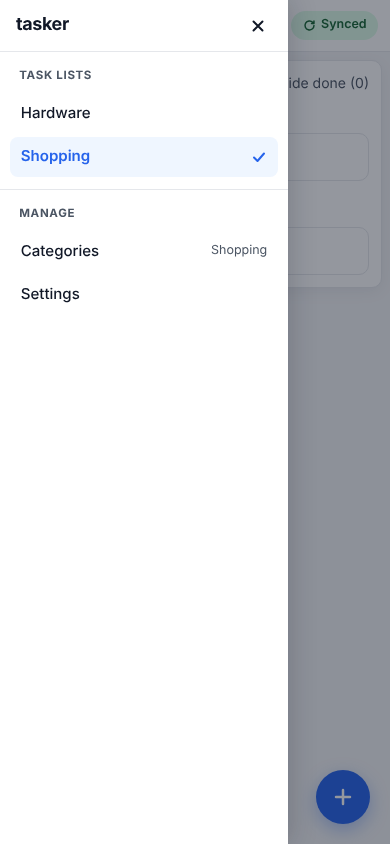
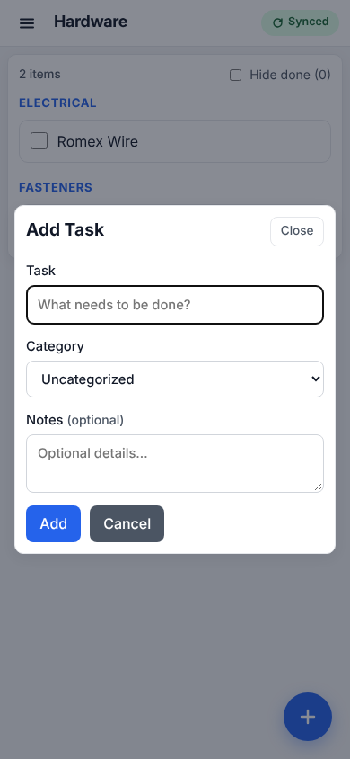

# tasker — Progressive Web App (`@tasker/web`)

Offline-first Progressive Web App for managing Nextcloud CalDAV task lists, organizing per-list categories, and auto-categorizing tasks on-device.

| Mobile Side Drawer | Add Task Modal |
|---|---|
|  |  |

## Nextcloud Setup

### 1. Enable CORS with WebAppPassword

Because the PWA runs on a different origin than your Nextcloud server (for example, GitHub Pages or `localhost`), install the [WebAppPassword](https://apps.nextcloud.com/apps/webapppassword) Nextcloud app to add the required CORS headers for CalDAV and WebDAV:

1. Log in to Nextcloud as an administrator.
2. Go to **Apps** → search for **WebAppPassword** → click **Download and enable**.
3. Go to **Settings** → **WebAppPassword**.
4. Under **Allowed Origins**, add your PWA origin (e.g., `https://<your-github-username>.github.io` and `http://localhost:5173` for local dev).
5. Save the settings.

### 2. Create an App Password

1. In Nextcloud, go to **Personal Settings** → **Security**.
2. Under **Devices & sessions**, enter an app name (e.g., `tasker-web`) and click **Create new app password**.
3. Copy the generated password for use in **tasker**.

## Getting Started & Usage

1. Open the hosted PWA (or start it locally with `npm run dev` from the repository root).
2. On the **Settings** screen, enter:
   - **Nextcloud URL** — e.g., `https://cloud.example.com`
   - **Username** — your Nextcloud username
   - **App password** — the Nextcloud App Password created above
   - **Config JSON path** *(optional)* — a WebDAV file path such as `Notes/tasker-config.json` to share per-list category orders across your browser and Fitbit watch. If the file does not exist yet (`404`), the app offers a **Create config file** button to create it (including any missing parent folders).
3. Click **Connect**, select a VTODO task list, and click **Load tasks**.

### Everyday Workflow

- **Switch lists & navigate:** Tap the menu button (`☰`) or the active list title in the single-line header to open the side drawer. From there you can switch between any of your CalDAV task lists or open **Categories** and **Settings**.
- **Add tasks:** Tap the floating **`+`** button in the bottom-right corner to open the **Add Task** dialog (with summary, category picker, and optional notes).
- **Complete, edit & delete tasks:** Tap a checkbox to mark an item done (or **Clear done** to remove all checked items at once). Tap an item's title to edit it inline and reveal compact **Edit** (full details: category, notes, priority) and one-tap **Delete** buttons on the right.
- **Sync status:** The header pill shows `Synced`, `Syncing…`, `Offline`, or `Sync error`, plus a `N pending` badge when offline changes are queued. Tap the pill anytime to trigger a manual sync.

### Per-List Categories

Each task list maintains its own independent category order:

1. Open the side drawer (`☰`) and select **Categories** (shows `<Active List> Categories`).
2. Add, rename, reorder (`Up`/`Down`), or remove categories for the active list.
3. Changes are saved immediately to IndexedDB and, when a **Config JSON path** is configured, written to `categoriesByCalendar` in `tasker-config.json` so your Fitbit watch and other devices use the same per-list sort order.

### On-Device AI Auto-Categorization

In browsers that support the [Web Prompt API](https://developer.mozilla.org/en-US/docs/Web/API/Prompt_API) (`LanguageModel`):

1. Open **Settings** from the side drawer — the **Auto-Categorize (On-Device AI)** badge indicates whether a local model is ready or downloadable.
2. Enable the toggle to automatically step through uncategorized tasks one by one and assign each to a matching category from the current list's configured categories (or tap **Auto-categorize (N)** on the task list toolbar to run on demand, and **Stop** to cancel).
3. All inference runs locally in your browser; no task data is sent to any third-party service.

### Offline Mode & Conflicts

- Tasks, calendars, and pending edits are cached in IndexedDB (`tasker-db`), and the Service Worker caches the app shell so the PWA opens offline.
- When you reconnect, queued edits replay automatically with CalDAV `If-Match` ETag checks. If a task was modified on another device (`412 Precondition Failed`), a conflict banner lets you choose **Keep Local** or **Keep Server**.

## Local Development & Testing

Run from the repository root:

```bash
# Start Vite dev server (http://localhost:5173)
npm run dev

# Build production bundle (web/dist/)
npm run build:web

# Run unit & integration tests
npm -w @tasker/web run test

# Run Playwright E2E + zero-pixel visual regression tests
npm -w @tasker/web run test:e2e
```
