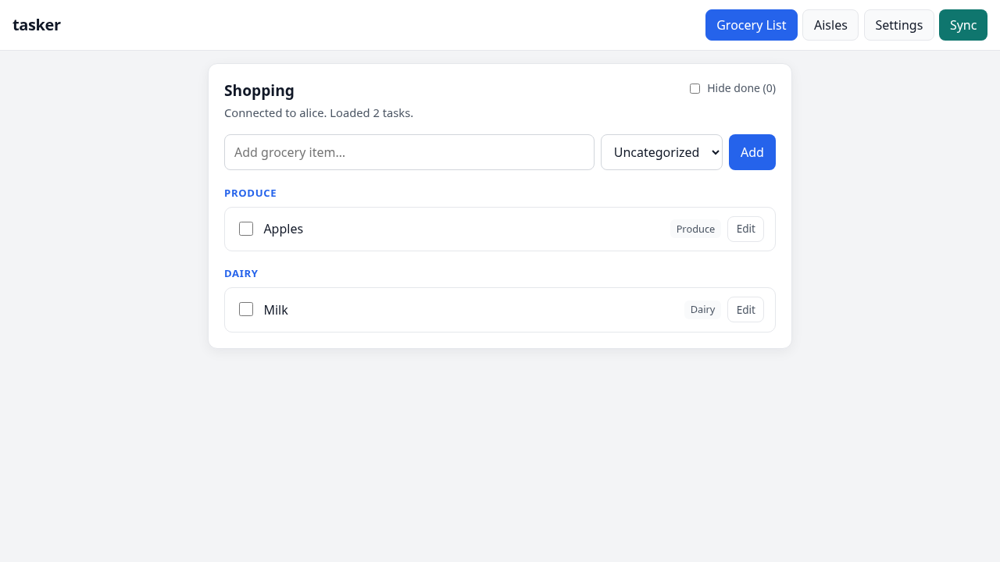
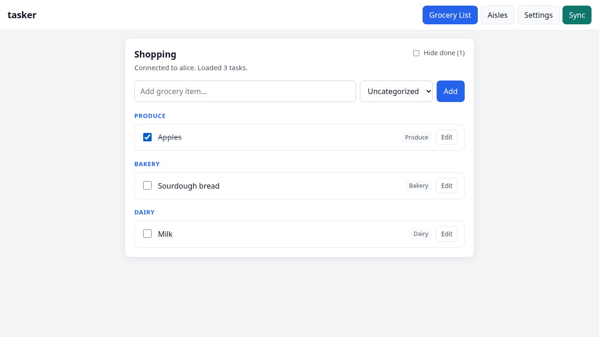
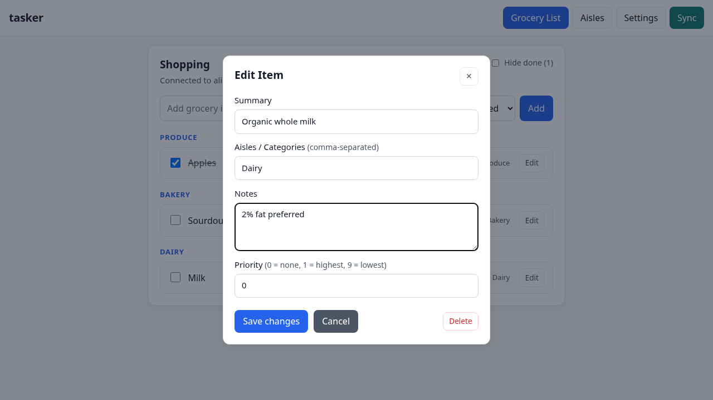
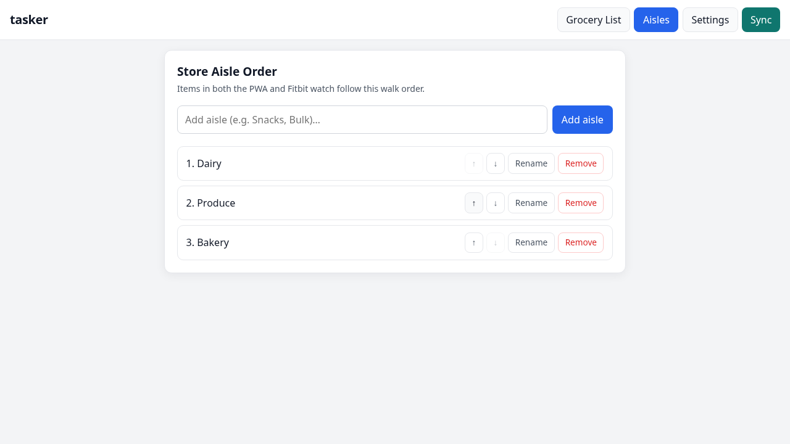
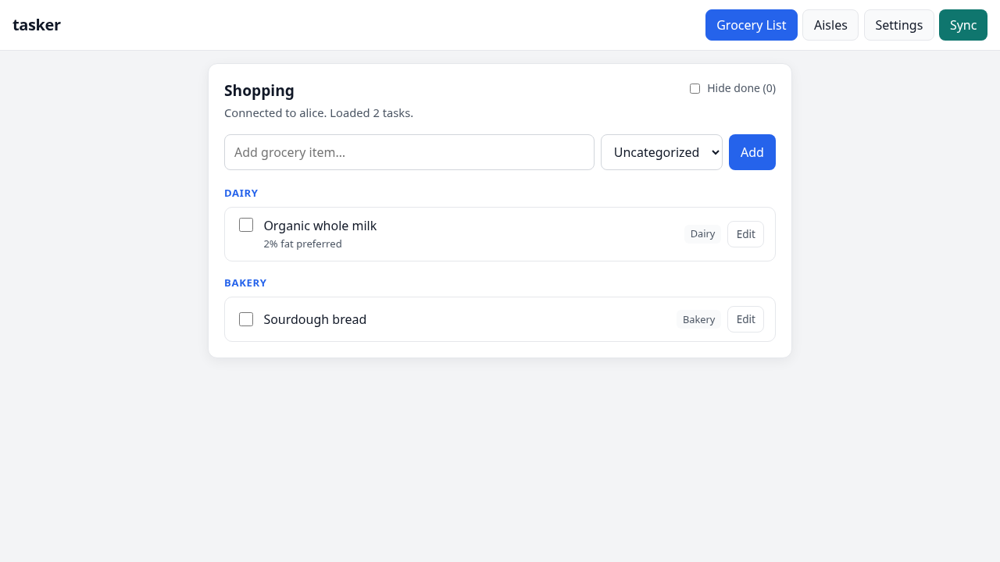

# Test: Grocery List CRUD & Aisle Sorting

As a shopper, I want items sorted by store aisle, and I want to add, check off, edit, reorder aisles, and delete items.

## Config bootstraps default list and sorts items by aisle walk order (Produce before Dairy)

**Verifications:**
- [x] Produce heading appears before Dairy heading
- [x] Both Apples and Milk are rendered

---

## Quick-added Bakery item slots between Produce and Dairy, and Apples is checked off

**Verifications:**
- [x] Aisle headings are ordered Produce, Bakery, Dairy
- [x] Server persisted 3 tasks with Apples marked COMPLETED

---

## Task editor modal allows updating summary, categories, notes, and priority

**Verifications:**
- [x] Task editor modal is visible with updated fields

---

## User reorders aisles in Aisle Manager (Dairy moved first)

**Verifications:**
- [x] Dairy is now first in the aisle list

---

## Grocery list reflects updated aisle order (Dairy first) and removed item is deleted on server

**Verifications:**
- [x] Dairy appears before Bakery
- [x] Server has 2 remaining tasks without Apples

---

