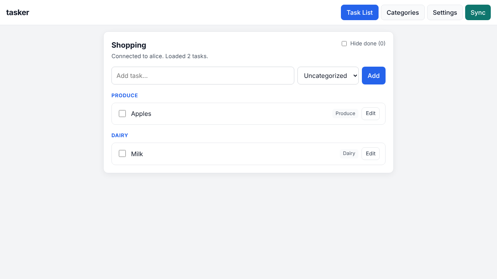
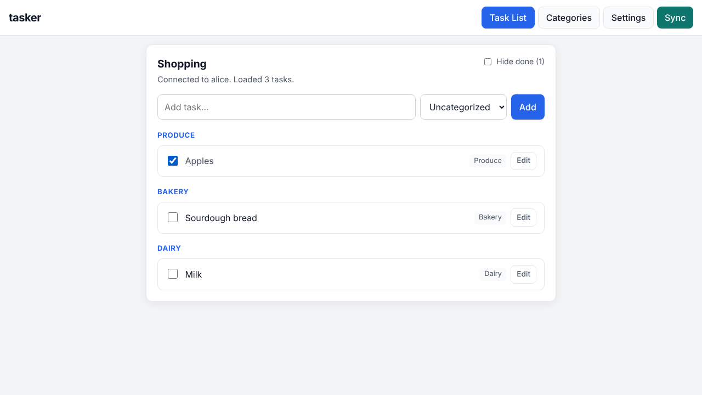
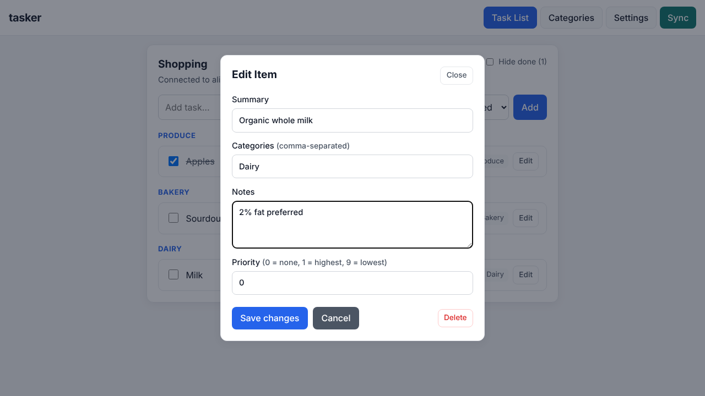
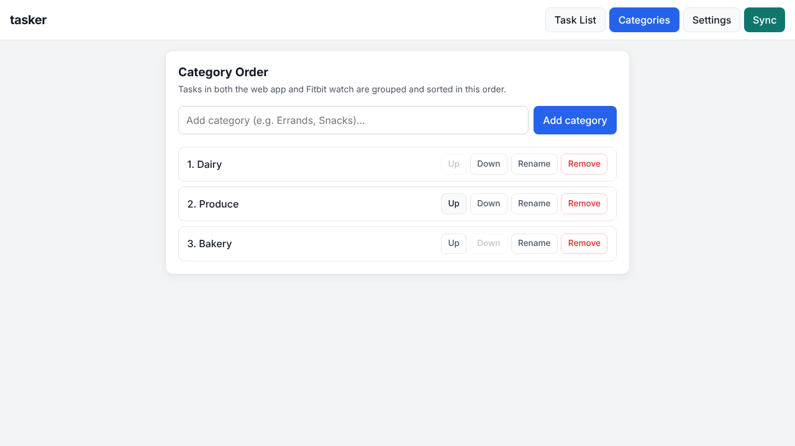
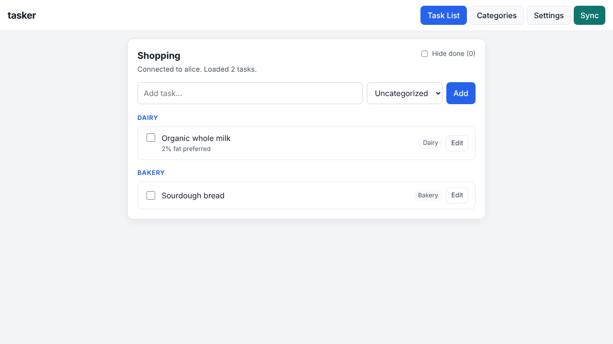

# Test: Task List CRUD & Category Sorting

As a user, I want tasks sorted by category order, and I want to add, check off, edit, reorder categories, and delete tasks.

## Config bootstraps default list and sorts items by category order (Produce before Dairy)

**Verifications:**
- [x] Produce heading appears before Dairy heading
- [x] Both Apples and Milk are rendered

---

## Quick-added Bakery item slots between Produce and Dairy, and Apples is checked off

**Verifications:**
- [x] Category headings are ordered Produce, Bakery, Dairy
- [x] Server persisted 3 tasks with Apples marked COMPLETED

---

## Task editor modal allows updating summary, categories, notes, and priority

**Verifications:**
- [x] Task editor modal is visible with updated fields

---

## User reorders categories in Category Manager (Dairy moved first)

**Verifications:**
- [x] Dairy is now first in the category list

---

## Task list reflects updated category order (Dairy first) and removed item is deleted on server

**Verifications:**
- [x] Dairy appears before Bakery
- [x] Server has 2 remaining tasks without Apples

---

