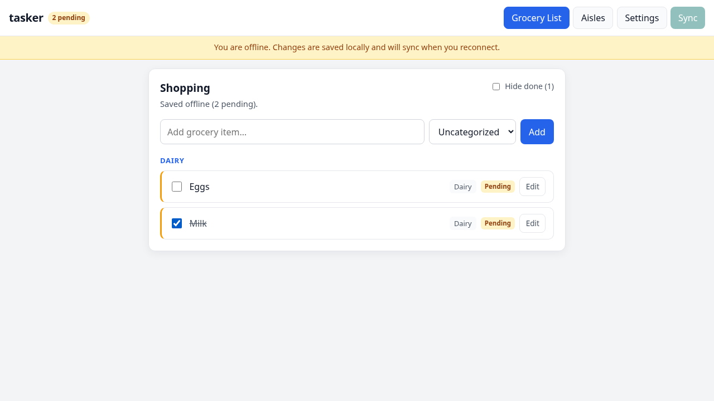
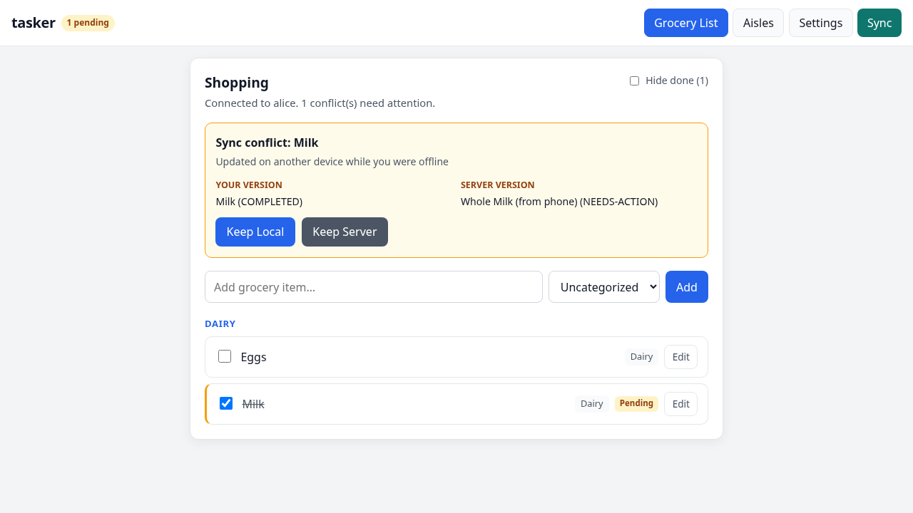
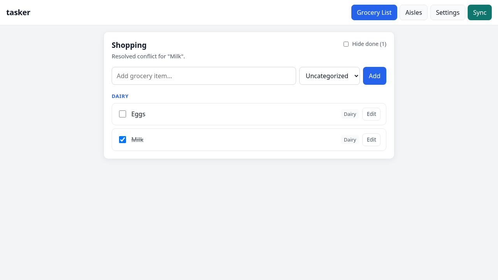

# Test: Offline Edits & Conflict Resolution

As a shopper in a store with poor reception, I want offline changes queued locally and conflicts surfaced cleanly when I reconnect.

## Offline banner and pending sync indicators show queued local edits

**Verifications:**
- [x] Offline banner is visible
- [x] Pending badge shows 2 queued changes
- [x] Newly added Eggs item renders immediately while offline

---

## Reconnecting syncs Eggs and surfaces the 412 conflict for Milk

**Verifications:**
- [x] Conflict banner shows local and server versions for Milk
- [x] Non-conflicting offline item Eggs synced to server

---

## Resolving the conflict clears the banner and persists the chosen version to CalDAV

**Verifications:**
- [x] Conflict banner is dismissed
- [x] Server reflects the kept local COMPLETED status for Milk

---

