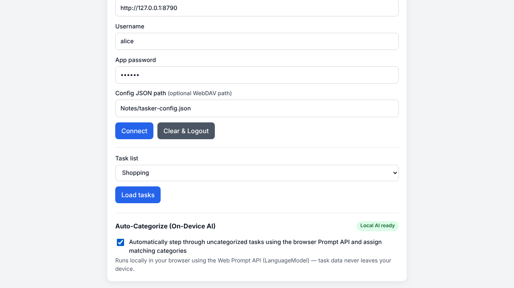
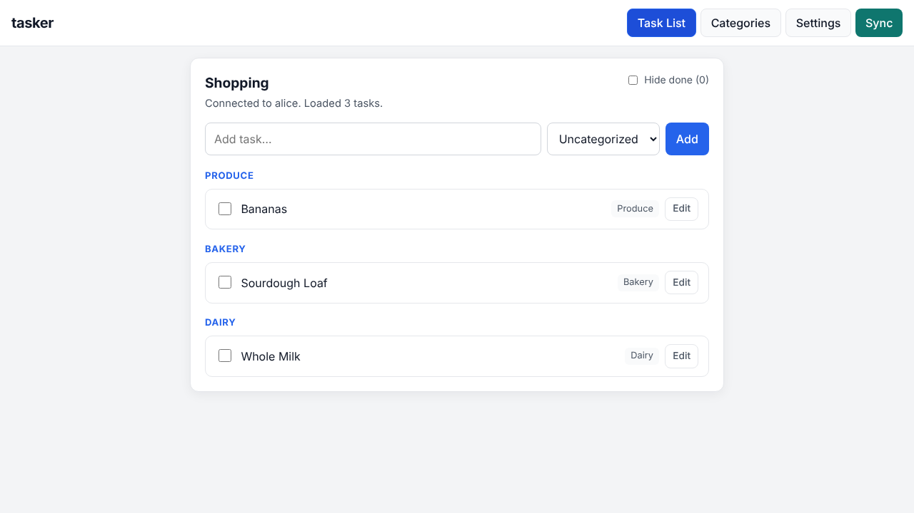
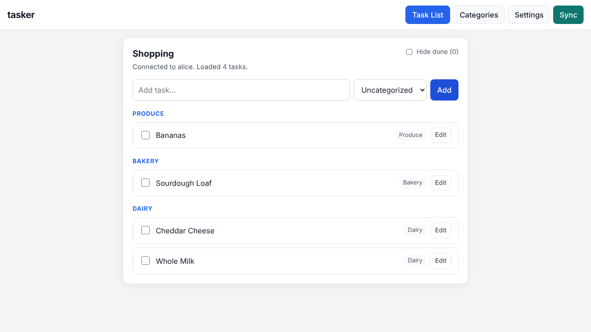

# Test: On-Device AI Auto-Categorize (Prompt API)

As a user with a browser supporting the Web Prompt API (LanguageModel), I want to enable Auto-Categorize so uncategorized tasks are stepped through one by one and assigned to matching categories automatically.

## Settings detects the browser Prompt API and lets the user enable Auto-Categorize

**Verifications:**
- [x] Prompt API badge shows Local AI ready
- [x] Auto-categorize setting is checked

---

## On-device AI steps through all 3 uncategorized items and assigns them into Produce, Bakery, and Dairy

**Verifications:**
- [x] All 3 items are grouped into Produce, Bakery, and Dairy in category order
- [x] Prompt API was called individually for each uncategorized task
- [x] CalDAV server persisted the assigned CATEGORIES for all 3 tasks

---

## Newly added uncategorized task is automatically categorized into Dairy by the local AI

**Verifications:**
- [x] Cheddar Cheese appears inside the Dairy category group
- [x] Server persisted Cheddar Cheese with CATEGORIES:Dairy

---

