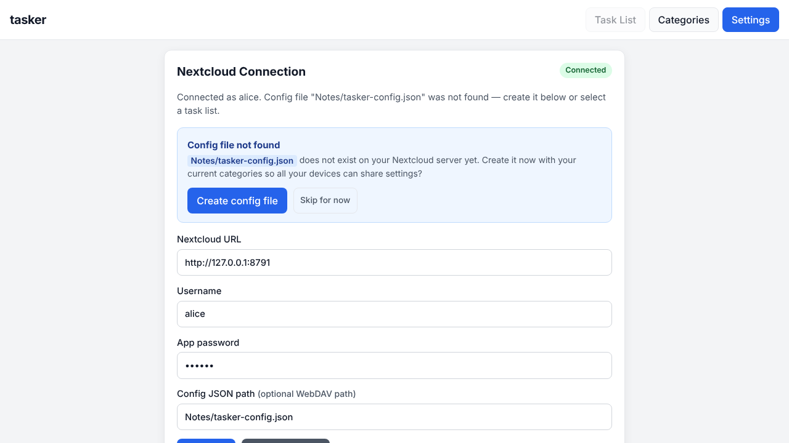
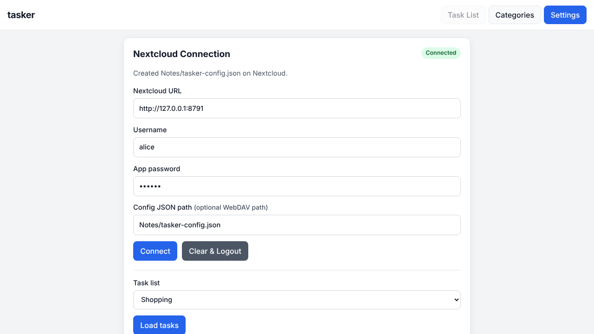

# Test: Create Missing Config File

As a user setting up a Config JSON path for the first time, if the file does not exist yet on Nextcloud (404), I want the app to offer to create it for me.

## Connecting with a non-existent config path connects to CalDAV and offers to create the missing config JSON file

**Verifications:**
- [x] Connection succeeds and shows missing config banner naming the path
- [x] Remote file does not exist yet before user confirms

---

## Clicking Create config file writes tasker-config.json to Nextcloud WebDAV and dismisses the prompt

**Verifications:**
- [x] Missing config banner is gone and confirmation status is shown
- [x] Mock WebDAV server now contains valid JSON with default categories

---

