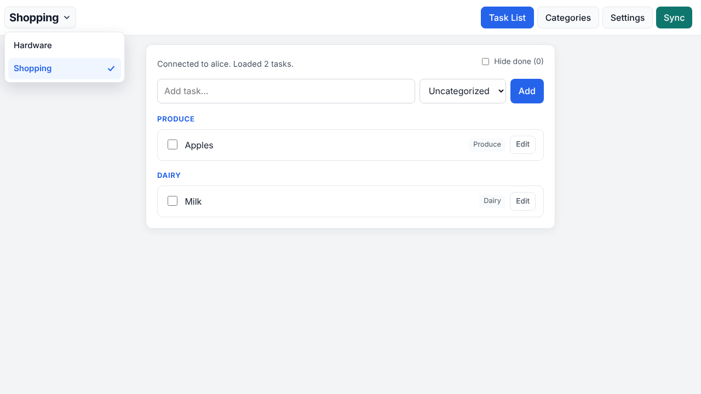
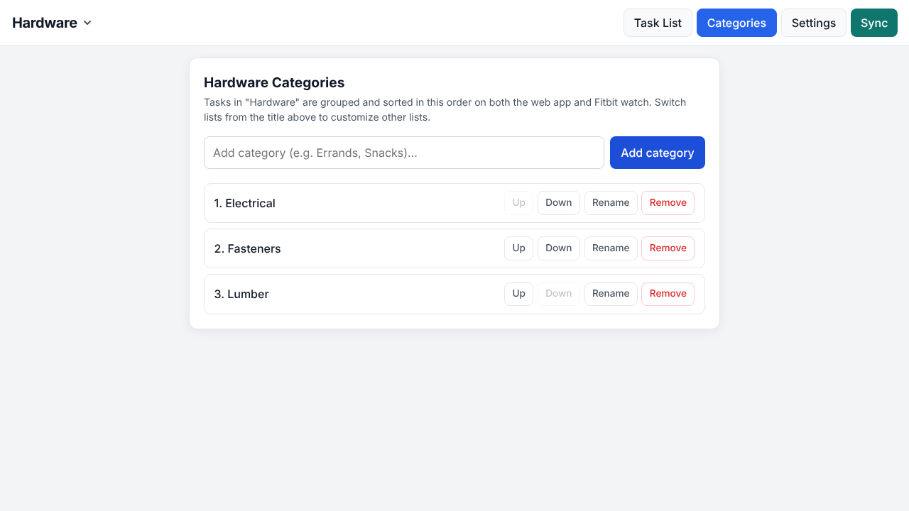

# Test: Quick List Switching & Per-List Categories

As a user with multiple task lists, I want the active list name as the main title so clicking it lets me switch lists immediately, and I want each list to maintain its own categories.

## Clicking the active list title in the header opens the quick list switcher menu

**Verifications:**
- [x] Main title shows Shopping and switcher menu lists Shopping and Hardware

---

## Selecting Hardware updates the main title and loads Hardware tasks sorted by its own categories

**Verifications:**
- [x] Main title is Hardware and tasks are grouped Electrical before Fasteners

---

## Categories tab edits categories specifically for Hardware without modifying Shopping

**Verifications:**
- [x] Hardware Categories shows Electrical, Fasteners, Lumber
- [x] Remote tasker-config.json preserves Shopping categories independently from Hardware

---

