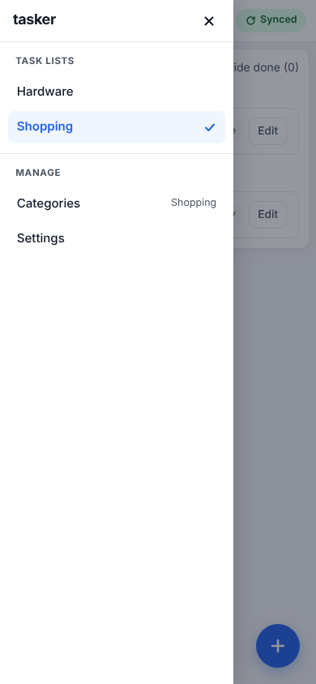
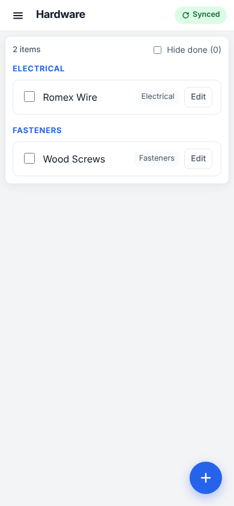
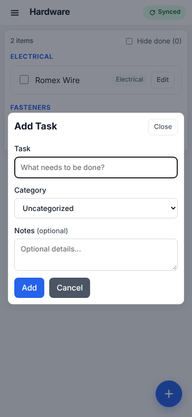
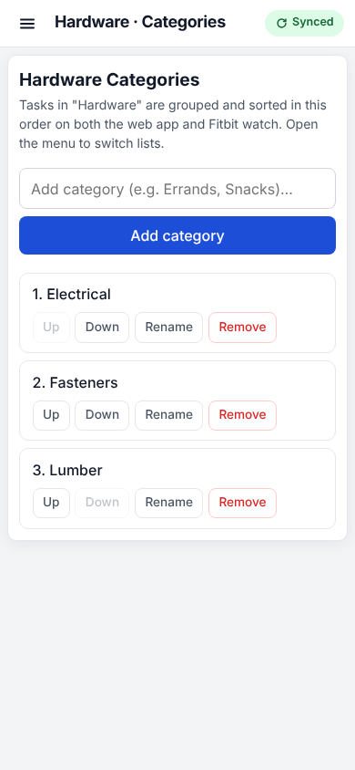

# Test: Compact Mobile Layout, Side Drawer & Per-List Categories

As a mobile user, I want a compact single-line header showing the active list and sync status, a side drawer for switching lists and opening Categories/Settings, per-list categories, and a + button to open the new-task dialog.

## Side drawer lists all task lists alongside Categories and Settings while keeping the header to a single line

**Verifications:**
- [x] Side drawer shows Shopping (active), Hardware, Categories, and Settings

---

## Mobile view shows a single-line Hardware header, Hardware tasks sorted by its own categories, and a floating + button

**Verifications:**
- [x] Header shows Hardware and Synced on a single line
- [x] Hardware tasks are grouped Electrical before Fasteners and + button is visible

---

## Tapping the + button opens the New Task modal populated with Hardware categories

**Verifications:**
- [x] New Task dialog is visible with Electrical and Fasteners options

---

## Categories view edits categories specifically for Hardware without modifying Shopping

**Verifications:**
- [x] Hardware Categories shows Electrical, Fasteners, Lumber
- [x] Remote tasker-config.json preserves Shopping categories independently from Hardware

---

