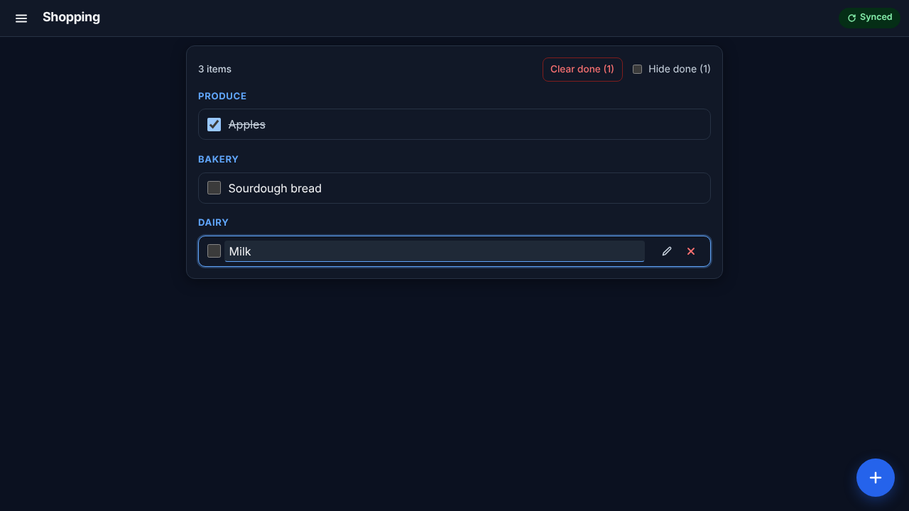
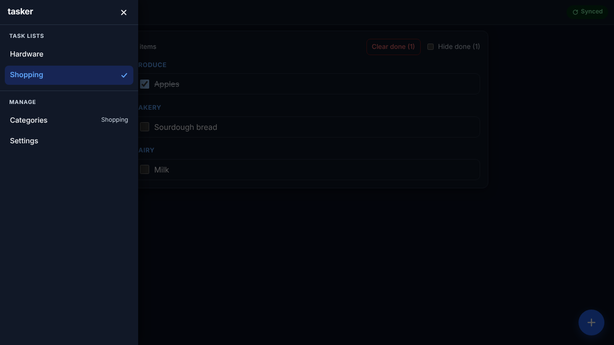

# Test: Automatic Dark Mode

As a user with system dark mode enabled, I want the PWA to automatically adopt a dark color scheme with high-contrast text and action icons.

## Dark mode renders deep slate surfaces, bright typography, and high-contrast pencil/cross icons on the focused task row

**Verifications:**
- [x] Root element advertises color-scheme: dark light and dark background
- [x] Pencil (Edit) and Cross (Delete) icons use bright high-contrast colors in dark mode

---

## Side drawer adopts dark surfaces with high-contrast active state and checkmark icon

**Verifications:**
- [x] Side drawer is visible with Shopping marked active

---

